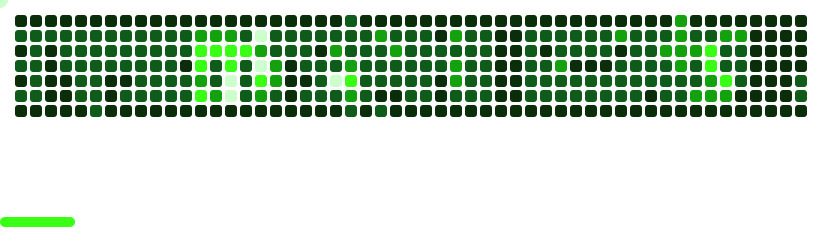

<h1 align="center">Hi, I'm Maxime 👋</h1>
<h3 align="center">Full-stack Laravel · Vue.js developer · Lead Tech SaaS · Freelance 🏆 CodinGame Top 150</h3>

  

---

### 🧑‍💻 About me

- 🚀 Full-stack **Laravel · Vue.js** developer and **Lead Tech** on SaaS products
- 🏗️ Currently leading the full rewrite of a consumer SaaS: legacy → Laravel + Vue/Inertia, **210+ tables migrated**, 160k+ accounts across 6 countries, shipped with **zero downtime**
- 🔧 I take over, refactor and rescue Laravel apps in production: audits, legacy migrations, version upgrades, critical bug fixes
- 💳 Payments & integrations (Stripe, banking APIs), Docker, CI/CD, Nginx: from design to deployment
- 🏆 **Top 150 worldwide on [CodinGame](https://www.codingame.com/profile/b50574ae1c4f6ba9b678601d20d2fe660000515)** (top 0.01%)
- 💼 **Open to freelance missions**: short assignments, team reinforcement, production troubleshooting, full remote from Tours, France 🇫🇷
  
### 🛠️ Tech stack

    
  
  
  
  

### 📫 Contact

  
    

<!--
**Maxime22440/Maxime22440** is a ✨ _special_ ✨ repository because its `README.md` (this file) appears on your GitHub profile.

Here are some ideas to get you started:

- 🔭 I’m currently working on ...
- 🌱 I’m currently learning ...
- 👯 I’m looking to collaborate on ...
- 🤔 I’m looking for help with ...
- 💬 Ask me about ...
- 📫 How to reach me: ...
- 😄 Pronouns: ...
- ⚡ Fun fact: ...
-->
